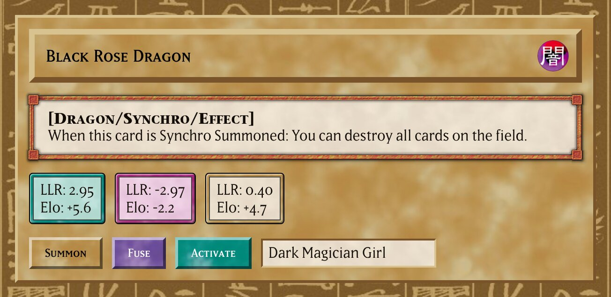
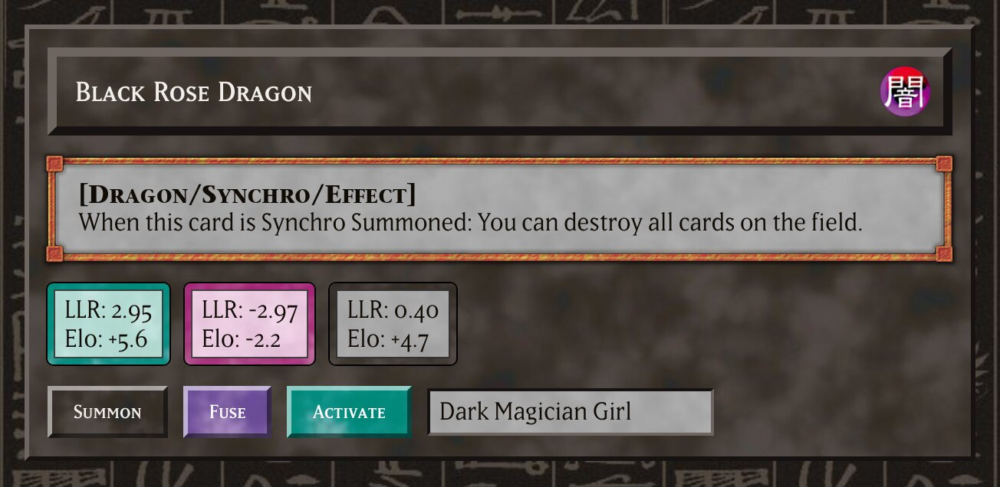

# ygo.css

A CSS library that looks like Yu-Gi-Oh! cards. It has card frames, name boxes, text boxes and
attributes. The edges are hard bevels, as in Windows 98. It works like
[98.css](https://github.com/jdan/98.css): it styles some elements directly and gives classes for
the rest.

Docs and examples: https://tsoj.github.io/ygo.css/




## Use

Put the `ygo.css` folder into your project. Then add to `<head>`:

```html
<script src="ygo.css/ygo.js"></script>
<link rel="stylesheet" href="ygo.css/ygo.css">
```

`ygo.css` loads its images and fonts from `assets/`. Keep that folder next to it.

## Card types

Set the card type with `data-card` on an element. The elements inside it get the same type.

Types: `normal`, `effect`, `ritual`, `fusion`, `synchro`, `xyz`, `link`, `spell`, `trap`,
`dark-synchro`.

Without `data-card`, the type is Normal. In the dark theme, it is Dark Synchro.

## Components

| Class or element | Look |
|---|---|
| `body` | A wall of hieroglyphs |
| `.card-frame` | A panel of card frame |
| `.name-box` | The box with the card name |
| `.attribute` | An attribute icon. Set it with `data-attribute`: `dark` (the default), `light`, `earth`, `fire`, `water`, `wind`, `divine`, `spell`, `trap` |
| `.text-box` | The text box of a card. Use `.type-line` in it for `[Spellcaster/Effect]` |
| `table.text-box` | A text box with lines between the rows |
| `.stat-box` | A small box with a frame ring in its card type |
| `.art-box` | A dark box in a steel frame, for code or output |
| `button`, `.button` | A raised box. It looks pushed in when you click it |
| `input`, `select`, `textarea` | A sunken text box |
| `hr` | An engraved line |

## Light and dark theme

The light theme is the default. `data-theme="dark"` on `<html>` sets the dark theme.

`ygo.js` does this for you:

- It sets the theme before the page shows. The choice is kept in `localStorage`.
- A click on an element with the class `ygo-theme-toggle` changes the theme.

An attribute makes a good theme button. It shows the attribute of the other theme:

```html
<button class="attribute ygo-theme-toggle" type="button" aria-label="Light or dark theme"></button>
```

## Variables

Your own CSS can use these variables:

| Variable | Value |
|---|---|
| `--card-frame` | The frame texture. Draw it as a 512px tile |
| `--card-frame-small` | The frame texture as a 256px tile |
| `--card-text` | The text box texture as a 256px tile |
| `--card-hi`, `--card-lo` | The light and the dark edge color of the card type |
| `--card-ink` | The text color on the frame |
| `--ygo-raised`, `--ygo-sunken` | Border colors for raised and sunken edges |
| `--ygo-text-box-frame` | The frame image of the text box |
| `--ygo-font-name`, `--ygo-font-text`, `--ygo-font-type` | The card fonts |
| `--ygo-ink`, `--ygo-link` | Text and link color on a text box |

Draw each texture at its own size. A scaled tile can show thin lines at its edges.

## Assets

`tools/make_assets.py` makes the images in `assets/`. Read the top of the file for the commands.

- The textures are noise in the colors of the card templates of
  [kooriookami/yugioh-card](https://github.com/kooriookami/yugioh-card).
- The text box frame is cut from these templates.
- The fonts and the attribute icons are from the same project.
- The wall is from the Papyrus of Ani
  ([Wikimedia Commons](https://commons.wikimedia.org/wiki/File:Papyrus_ani_curs_hiero.jpg),
  public domain). One glyph is made from a Black Rose Dragon picture.
- `docs/example.html` is the page of the images above.

## License

The code (CSS, JavaScript, Python) has the MIT license. The card designs, the fonts and the card
art belong to their owners (Konami, the font makers, the artists). This is a fan project.
